# ⚡ Awesome IoT Hardware & Smartphone Bridging 📱

  <strong>Curated directory of top-tier IoT hardware-to-smartphone bridging platforms, mobile microcontroller dashboards, BLE/Wi-Fi telemetry gateways, and home automation hubs.</strong>

  
  
  
  
  

  🌟 Star if you find this list helpful! 🌟

---

## 📖 Table of Contents

- [🌐 SaaS / Hosted Platforms](#-saashosted-platforms)
  - [📊 Sector Overview & Market Dynamics](#-sector-overview--market-dynamics)
  - [🏷️ SaaS Platforms Comparison](#️-saas-platforms-comparison)
- [🛠️ Open-Source Equivalents & Tools](#️-open-source-equivalents--tools)
  - [📶 ESP32 & Smartphone Direct Bridging Frameworks](#-esp32--smartphone-direct-bridging-frameworks)
  - [🏠 Smart Home & Mobile App Orchestration Hubs](#-smart-home--mobile-app-orchestration-hubs)
  - [📊 Self-Hosted IoT Dashboards & Device Management Platforms](#-self-hosted-iot-dashboards--device-management-platforms)
  - [⚡ Custom Microcontroller Firmware & No-Code IoT Builders](#-custom-microcontroller-firmware--no-code-iot-builders)
  - [📨 High-Throughput MQTT Brokers & Telemetry Bridges](#-high-throughput-mqtt-brokers--telemetry-bridges)
- [🤝 Contributing](#-contributing)
- [💖 Support](#-support)
- [📈 Star History](#-star-history)

---

## 🌐 SaaS/Hosted Platforms

### 📊 Sector Overview & Market Dynamics

The global IoT platform and device enablement market is estimated between **$17 billion and $45+ billion** (projected to reach $100B+ by 2030 at ~12–15% CAGR). The sector is **moderately fragmented**: while hyperscale cloud providers (AWS, Microsoft, Google) command major enterprise cloud infrastructure, no single vendor captures a dominant market majority (>15% share), enabling specialized IoT-native platforms, mobile-dashboard ecosystems, and low-code hardware bridging suites to thrive across vertical niches.

### 🏷️ SaaS Platforms Comparison

| Company / Platform | Estimated Size (Revenue / Valuation) | Pricing (Starting Tier) | Free Tier Limits / Trial | Key Capabilities & Protocols |
| :--- | :--- | :--- | :--- | :--- |
| **[AWS IoT Core](https://amazon.com)** | **$100B+ AWS rev** / ~$2.2T market cap (Amazon) | **$1.00 / 1M messages** + $0.08 / 1M connection minutes | **12-Month Free Tier**: 2,250,000 connection minutes, 500,000 messages (5 KB units), 250,000 rules/actions, and 225,000 registry operations/month | Managed enterprise cloud broker, device shadow/digital twin, rules engine, MQTT, HTTP, WebSockets, cellular/LoRaWAN |
| **[Tuya Developer Platform](https://tuya.com)** | **~$340M ARR** / ~$950M Market Cap (NYSE: TUYA) | **$5,000 / year** (Standard Cloud Edition; or ~$0.69/device license) | **Free Trial Edition (perpetual non-commercial)**: Up to 50 devices added, 10 controllable devices, ~26k-30k API calls/month, ~68k-80k message subscriptions | Global consumer/smart-home PaaS, OEM white-label iOS/Android apps, hardware module turn-key firmware, cloud APIs |
| **[Arduino Cloud](https://arduino.cc)** | **~$140M - $250M rev** / ~$59M VC raised | **$6.00 / month** ($72 billed annually for Maker Plan) | **Free Forever Plan**: 2 connected Things, 5 variables per Thing, 1-day data retention, 100k daily data points, 25 compilations/day (no OTA) | Official Arduino/ESP32 cloud, web dashboard builder, smartphone remote app, Webhooks, API access |
| **[Particle Cloud](https://particle.io)** | **~$20M ARR** / $50M acquisition (Digi Intl) | **$299 / month per block** (Basic Plan for up to 100 devices) | **Free Forever Developer Sandbox**: Up to 100 devices, 100,000 Data Operations/month, unmetered cellular/OTA data handshakes included | Integrated cellular/Wi-Fi/satellite hardware-to-cloud, device twins, OTA firmware orchestration, mobile SDKs |
| **[Adafruit IO](https://adafruit.com)** | **~$25M - $50M rev** / Bootstrapped | **$10.00 / month** (or $99/year for IO+) | **Free Forever Basic Plan**: 30 data points/minute throttle, 30-day historical data retention, 10 feeds, 5 dashboards, 2 WipperSnapper devices | Maker-focused MQTT/REST cloud data service, drag-and-drop dashboard builder, WipperSnapper no-code ESP32 firmware |
| **[ThingsBoard Cloud](https://thingsboard.cloud)** | **~$5M - $9M ARR** / Bootstrapped | **$49.00 / month** (Prototype tier) | **Free Forever Plan**: Up to 5 devices, 5 assets, 5 dashboards, 2 customers, 3 rule chains, 50 MB OTA package limit | Managed multi-tenant IoT application server, customizable Flutter mobile apps, rule engine, MQTT/CoAP/HTTP |
| **[Losant](https://losant.com)** | **~$3M - $6.5M ARR** / ~$25M VC raised | **~$250.00 / month** (Starting Pilot/Production tier) | **Free Forever Developer Sandbox**: Up to 10 devices, 30 days data retention, full Visual Workflow Engine access; plus 60-day Enterprise Trial | Visual drag-and-drop workflow engine, edge compute agent, white-label end-user mobile/web experiences |
| **[Blynk IoT](https://blynk.io)** | **~$3.7M ARR** / Seed/Venture Backed | **$29.00 / month** (Starter plan) | **Free Forever Exploration Plan**: Up to 5 devices, 1 user, 1-week data retention, 100,000 device messages/month, 10 device templates | Low-code mobile app builder (iOS/Android), cloud dashboards, automated device provisioning, OTA updates for ESP32/Pi |
| **[Ubidots](https://ubidots.com)** | **~$2.5M - $4.5M ARR** / Bootstrapped | **$99.00 / month** (Professional plan) | **Free Forever STEM Plan**: Up to 3 devices (10 variables each), 1 dashboard (10 widgets), 4,000 dots/day ingestion, 1-month retention (plus 30-day Core Trial) | Low-code IoT application development, synthetic variables, scheduled alerts (SMS/Email/Voice), white-label client portals |
| **[Datacake](https://datacake.co)** | **~$1M ARR** / €1.2M VC raised | **€25.00 / month** (~$27/mo for Hobby plan up to 25 devices) | **Free Forever Plan**: Up to 5 devices, full dashboard builder & basic rules, built-in LoRaWAN Network Server with unlimited gateways | Low-code IoT dashboard, native LoRaWAN Network Server (LNS), MQTT/API connectors, mobile-friendly responsive dashboards |

---

## 🛠️ Open-Source Equivalents & Tools

Free and open-source software (FOSS) smartphone-to-hardware bridges, self-hosted IoT dashboards, local smart-home mobile hubs, microcontroller firmwares, and MQTT brokers. Sorted in descending order by GitHub stars.

### 📶 ESP32 & Smartphone Direct Bridging Frameworks

* **[esp32-iphone-agent](https://github.com/onehumanbeing/esp32-iphone-agent)**  - Direct bridging framework connecting ESP32 microcontrollers with iPhone capabilities for seamless iOS mobile-to-hardware interaction.
* **[Blynk Library](https://github.com/blynkkk/blynk-library)**  - Official open-source C++ microcontroller client library supporting ESP32, ESP8266, Arduino, and Linux boards for low-code mobile app bridging.
* **[ESP-DASH](https://github.com/ayushsharma82/ESP-DASH)**  - Blazingly fast, modern C++ library creating real-time, responsive smartphone and desktop web dashboards hosted directly in microcontrollers without external cloud servers.
* **[Bluepad32](https://github.com/ricardoquesada/bluepad32)**  - Open-source Bluetooth host firmware turning ESP32 boards into universal receivers bridging smartphones, gamepads, mice, keyboards, and custom HID devices to hardware.
* **[ESP-RainMaker](https://github.com/espressif/esp-rainmaker)**  - Espressif's end-to-end cloud and mobile ecosystem enabling zero-code mobile UI generation (iOS/Android) for ESP32-S2/S3/C3 modules via local Wi-Fi, BLE, and AWS.
* **[Thinger.io Arduino Client](https://github.com/thinger-io/Arduino-Library)**  - Lightweight client library connecting ESP8266, ESP32, and Arduino devices directly to Thinger.io mobile dashboards and REST/WebSockets endpoints.
* **[Dabble ESP32](https://github.com/STEMpedia/DabbleESP32)**  - Arduino/ESP32 BLE bridging library transforming iOS and Android smartphones into virtual hardware shields (gamepad, pin control, accelerometer, GPS, camera stream).

### 🏠 Smart Home & Mobile App Orchestration Hubs

* **[Home Assistant](https://github.com/home-assistant/core)**  - The world's leading open-source home automation platform featuring official iOS and Android companion apps that bridge phone sensors, NFC tags, geofencing, and notifications directly to IoT hardware.
* **[WLED](https://github.com/Aircoookie/WLED)**  - Fast and feature-rich ESP8266/ESP32 implementation for addressable NeoPixel/WS2812B LEDs with dedicated iOS and Android companion apps for instant smartphone control.
* **[Zigbee2MQTT](https://github.com/Koenkk/zigbee2mqtt)**  - Seamless bridge connecting Zigbee hardware networks to MQTT message streams, allowing integration with custom smartphone dashboards and local hubs.
* **[Domoticz](https://github.com/domoticz/domoticz)**  - Highly optimized, lightweight C++ home automation system supporting hundreds of sensors, switches, RF devices, and native smartphone companion apps.
* **[Gladys Assistant](https://github.com/gladysassistant/gladys)**  - Privacy-focused open-source home automation assistant with modern mobile Progressive Web App (PWA) support, camera integration, and Telegram/chat bridging.
* **[ioBroker](https://github.com/ioBroker/ioBroker)**  - Modular integration platform connecting hundreds of IoT devices and communication protocols to custom mobile touch interfaces and smartphone notifications.
* **[openHAB](https://github.com/openhab/openhab-core)**  - Vendor-neutral open-source smart home system implemented in Java, featuring native mobile apps for iOS and Android with NFC, push notifications, and customizable UI widgets.

### 📊 Self-Hosted IoT Dashboards & Device Management Platforms

* **[Node-RED](https://github.com/node-red/node-red)**  - Flow-based visual programming environment connecting hardware devices, APIs, and online services with rich responsive mobile dashboards (Dashboard 2.0).
* **[ThingsBoard](https://github.com/thingsboard/thingsboard)**  - Industry-standard open-source IoT platform for telemetry collection, device management, rule processing, and customizable Flutter mobile applications.
* **[DeviceHive](https://github.com/devicehive/devicehive-java-server)**  - Scalable open-source IoT data platform offering REST and WebSocket APIs to bridge smart hardware with mobile apps and machine learning pipelines.
* **[Mainflux / Magistrala](https://github.com/mainflux/mainflux)**  - High-performance, open-source Go-based IoT cloud platform supporting multi-tenant device twins, MQTT, CoAP, and HTTP device connectivity.

### ⚡ Custom Microcontroller Firmware & No-Code IoT Builders

* **[Tasmota](https://github.com/arendst/Tasmota)**  - Highly configurable open-source firmware for ESP8266 and ESP32 hardware, liberating smart devices from proprietary vendor clouds with local WebUI and MQTT.
* **[MicroPython](https://github.com/micropython/micropython)**  - Lean and efficient Python 3 implementation optimized to run on microcontrollers, ideal for prototyping fast BLE/Wi-Fi smartphone communication bridges.
* **[ESPHome](https://github.com/esphome/esphome)**  - Declarative YAML-based firmware builder for ESP8266/ESP32 and RP2040 microcontrollers with seamless native Home Assistant and mobile telemetry integration.
* **[ESPurna](https://github.com/xoseperez/espurna)**  - Custom open-source firmware for ESP8266 and ESP32 smart home devices focusing on stability, low power, mobile-friendly WebUI, and MQTT bridging.
* **[OpenBeken (OpenBK7231T_App)](https://github.com/openshwprojects/OpenBK7231T_App)**  - Free and open-source Tasmota-compatible firmware replacement for non-ESP Wi-Fi chips (Beken BK7231, Bouffalo Lab BL602, WinnerMicro W800) found in commercial Tuya hardware.

### 📨 High-Throughput MQTT Brokers & Telemetry Bridges

* **[EMQX](https://github.com/emqx/emqx)**  - High-performance, distributed open-source MQTT 5.0 broker written in Erlang, engineered to handle tens of millions of concurrent IoT and mobile client connections.
* **[Eclipse Mosquitto](https://github.com/eclipse/mosquitto)**  - Lightweight, industry-standard open-source C message broker implementing MQTT v5.0 and v3.1.1, ideal for edge gateways, low-power devices, and mobile telemetry.
* **[NanoMQ](https://github.com/nanomq/nanomq)**  - Ultra-lightweight, blazingly fast edge MQTT broker designed for IoT gateways and embedded microprocessors with minimal memory footprint.
* **[OwnTracks](https://github.com/owntracks/recorder)**  - Open-source mobile location and telemetry bridging platform streaming smartphone GPS events, beacons, and geofencing triggers to self-hosted MQTT/HTTP servers.
* **[HiveMQ Community Edition](https://github.com/hivemq/hivemq-community-edition)**  - Java-based open-source MQTT broker supporting 10,000 concurrent mobile and sensor connections with high-throughput event processing.

---

## 🤝 Contributing

Contributions are warmly welcomed! If you know of an awesome open-source smartphone-to-hardware bridge, microcontroller dashboard, or IoT protocol gateway, please submit a pull request!

1. Fork the repository.
2. Add your project under the appropriate category in descending order of stars.
3. Include the stargazers badge: ``.
4. Provide a clear and concise description highlighting how it bridges hardware and mobile devices.
5. Open a Pull Request.

---

## 💖 Support

Thank you for exploring and using this repository! If you find it helpful for your projects, research, or development:

- ⭐ **Star** this repository to show your support and make it easier for others to discover.
- 🍴 **Fork** it to keep a copy and start contributing.
- 📢 **Share** it with fellow IoT developers, makers, and smart home enthusiasts.
- ☕ **Buy me a coffee**: If you'd like to support ongoing curation and development, consider sponsoring via the [GitHub Sponsor Dashboard](https://github.com/sponsors/ishandutta2007).

---

## 📈 Star History

---

  Maintained with ❤️ by <a href="https://github.com/ishandutta2007">Ishan Dutta</a> and the global open-source community.

